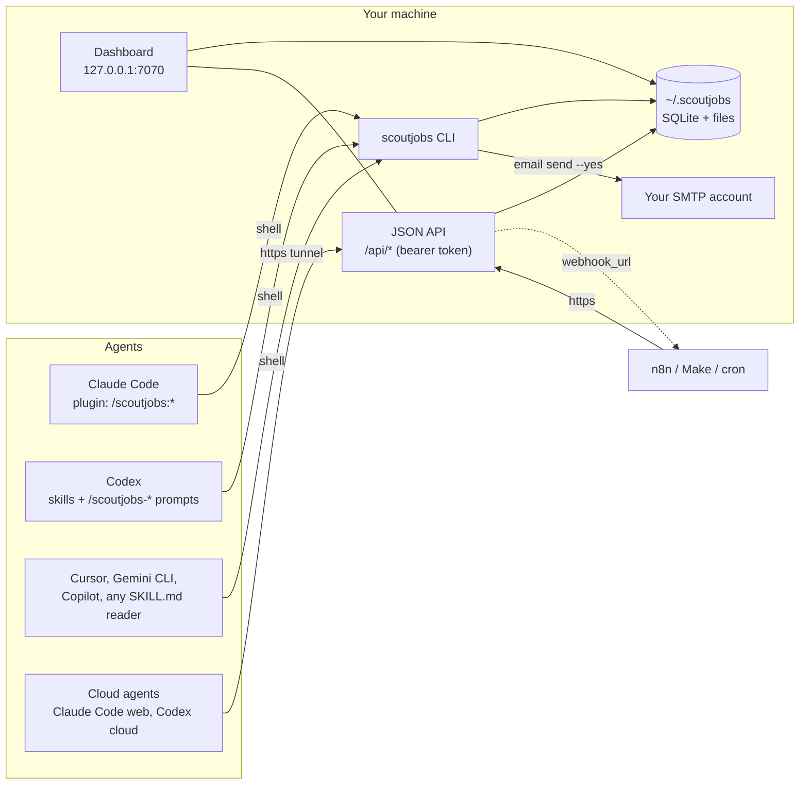
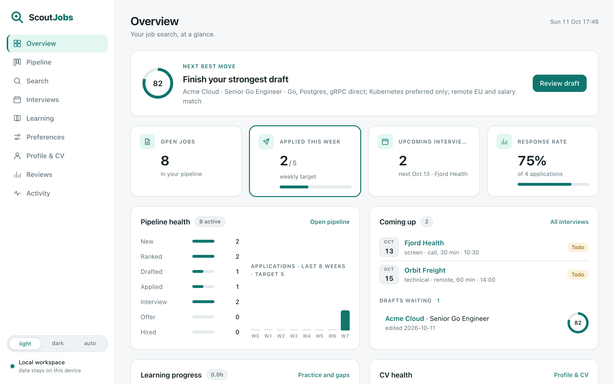
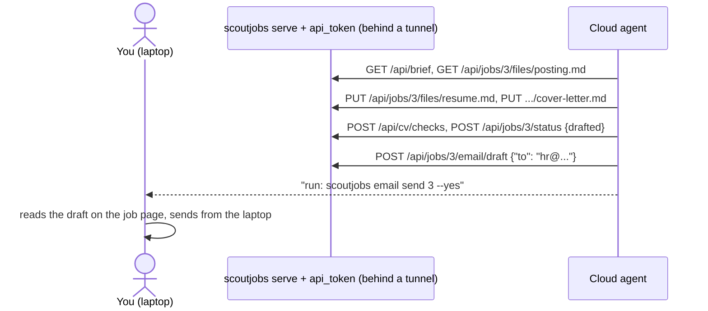
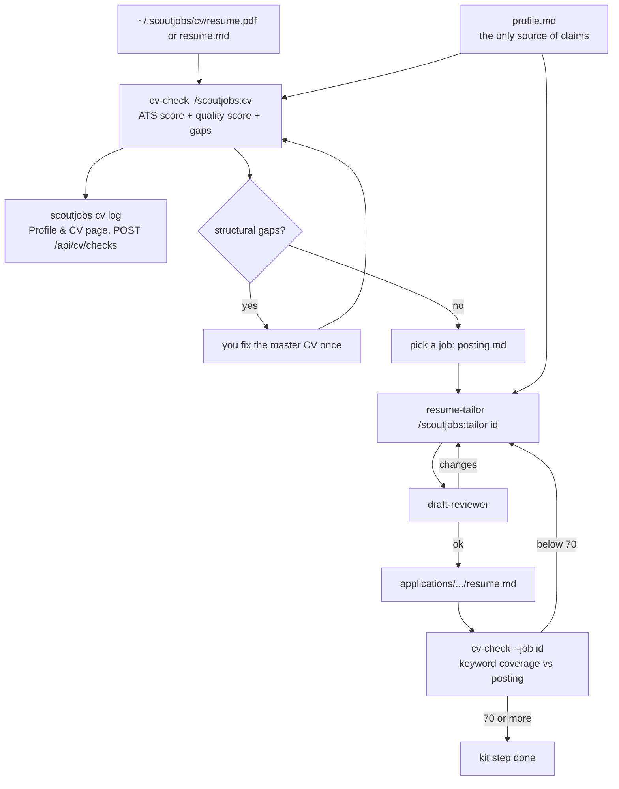
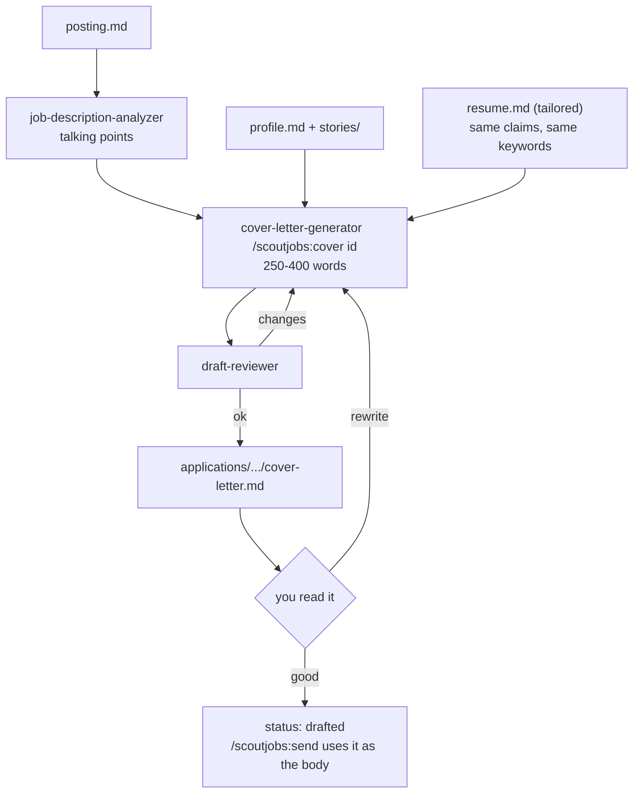
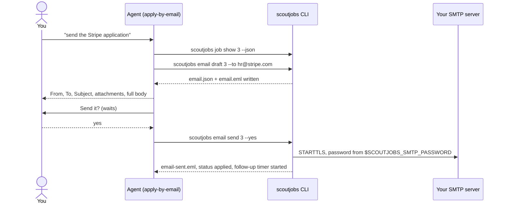
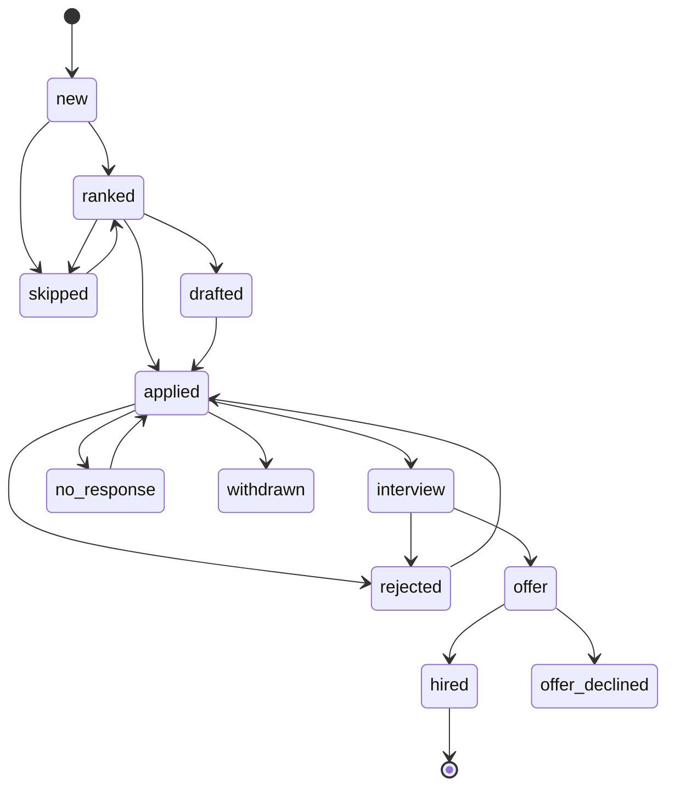
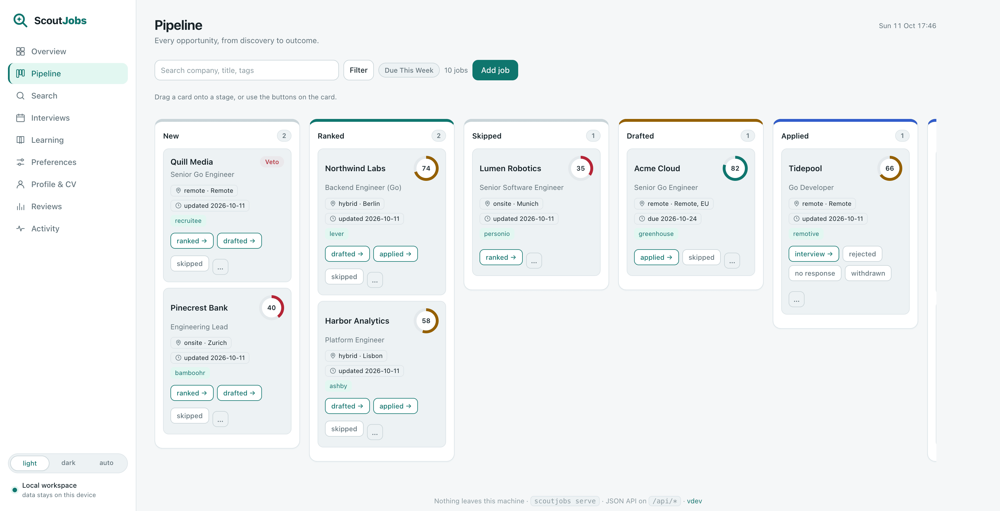
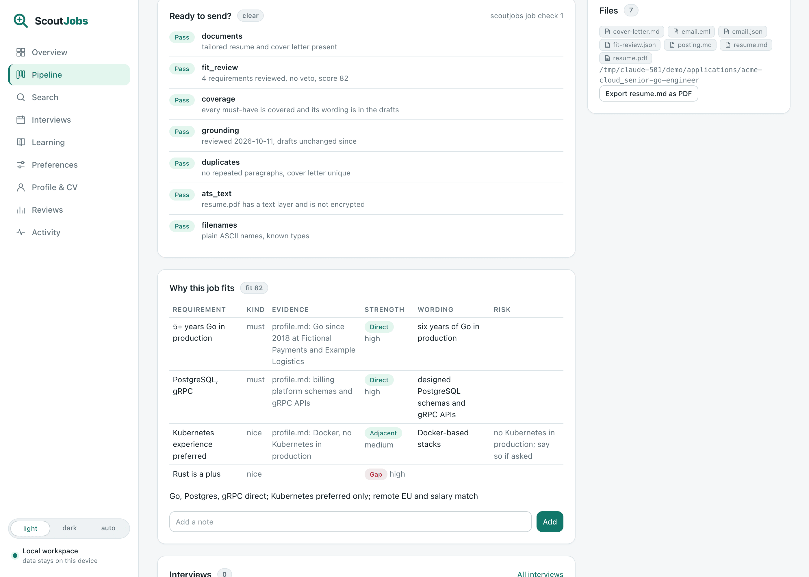

<p align="center">
<picture>
<source media="(prefers-color-scheme: dark)" srcset="design/logo/logo-dark.svg">

</picture>
</p>

<p align="center">
<a href="https://github.com/ZoolCoder/scoutjobs/releases/latest"></a>
<a href="https://github.com/ZoolCoder/scoutjobs/actions/workflows/release.yml"></a>
<a href="https://zoolcoder.github.io/scoutjobs/"></a>
<a href="LICENSE"></a>
<a href="https://github.com/ZoolCoder/scoutjobs/issues"></a>
</p>

Your job search, on your machine. An open-source job-search operating system for the person looking for a job, driven by AI coding agents. One repo gives you:

- **Skills** (Agent Skills standard) for the whole loop: find jobs, score fit, check your CV, tailor resume and cover letter, track applications, prep and mock interviews, debrief, negotiate, upskill.
- **A learning loop**: every skip, apply, withdraw and declined offer is logged with your reason. `learn-preferences` turns those into preferences you confirm, and the scorer and tailoring skills read them. It gets better the longer you use it.
- **A dashboard**: a single Go binary, SQLite, no Node, no JavaScript, no external assets, bound to localhost. Overview with your next best move, pipeline board where every card opens the job and moves to the next stage with one click or a drag, a per-job "get selected" checklist (tailored CV, cover letter, ATS check), drafts you can edit in place, a "due this week" filter, an add-job form and a board search page, weekly reviews next to the live funnel, interviews, learning progress, preferences it learned, profile and CV health, activity log. Light by default, dark and auto available.
- **A built-in job search**: `scoutjobs search` queries public ATS boards (Greenhouse, Lever, Ashby, Workable, SmartRecruiters, Personio, Recruitee, BambooHR) by slug or careers URL, any RSS feed and remote aggregators (Remotive, RemoteOK, Arbeitnow, Jobicy, Himalayas, HN Who is hiring) without an API key, imports a single posting by URL (`job add --from`), deduplicates by posting URL and normalised title, converts salaries to your currency, and adds results to the pipeline.
- **Apply by e-mail**: `scoutjobs email draft|send` builds the application from your cover letter and tailored resume and sends it through your own SMTP account. The CLI refuses without `--yes`, and the skill asks you first. Every job page also offers a `mailto:` link for your own mail app.
- **Automation hooks**: a JSON API on the dashboard and an outgoing webhook for n8n, Make, Zapier or cron. See `integrations/n8n/`.
- **Every platform**: Claude Code (plugin with slash commands and subagents), Codex (skills plus generated `/scoutjobs-*` prompts), Cursor, Gemini CLI, GitHub Copilot, and anything else that reads `SKILL.md`. Agents without a shell on your machine (Claude Code web, Codex cloud, hosted n8n) use the same features through the JSON API.

Your data never leaves `~/.scoutjobs`. There are no accounts, no keys, no telemetry.

**User manual:** https://zoolcoder.github.io/scoutjobs (built from `docs/` with Antora, `make docs` for a local copy).



## Quick start

```bash
git clone https://github.com/zoolcoder/scoutjobs && cd scoutjobs
./install.sh            # builds the CLI into ~/.local/bin (or downloads a release binary when Go is missing), links skills into every agent found
scoutjobs init           # creates ~/.scoutjobs with profile.md, preferences.md, config.yaml
scoutjobs serve          # dashboard at http://127.0.0.1:7070
```



CLI only: `brew install --cask zoolcoder/scoutjobs/scoutjobs`, a `deb`, `rpm` or `apk` package, or a binary for macOS, Linux and Windows from [Releases](https://github.com/zoolcoder/scoutjobs/releases). `scoutjobs doctor` checks the install, `scoutjobs update` installs the next release (checksum verified; Homebrew and package installs are handed to their manager).

Then in your agent: "set up scoutjobs" (runs the `scoutjobs-setup` skill: builds your profile from a CV, records what you want). After that the daily loop is:

| You say | Skill | What happens |
|---|---|---|
| "find go jobs, remote EU" | `job-search` | runs `scoutjobs search`: public ATS APIs and remote boards, deduplicated, added as `new` |
| "check my CV" | `cv-check` | ATS readiness and content score, gaps against your target roles, logged to Profile & CV |
| "score them" | `job-fit` | 0-100 with reasons, asks apply/skip, logs your decisions; hard failures become a veto outside the score |
| "what can I honestly claim" | `fit-review` | `/scoutjobs:evidence`: every requirement mapped to profile evidence, strength and defensible wording in `fit-review.json` |
| "is it ready to send" | `apply-by-email` | `/scoutjobs:check`: the quality gates (documents, review, coverage, grounding, duplicates, ATS text layer, filenames); `email send` refuses while one fails |
| "apply to Stripe" | `resume-tailor`, `cover-letter-generator` | drafts in `~/.scoutjobs/applications/<job>/`, reviewed by `draft-reviewer` |
| "rewrite the Stripe cover letter" | `cover-letter-generator` | `/scoutjobs:cover <id>`: rewrites the letter to the posting, reviewed again |
| "ATS check vs the Stripe job" | `cv-check` | `/scoutjobs:cv --job <id>`: keyword coverage and layout against that posting |
| "rewrite my CV for Stripe" | `resume-tailor` | `/scoutjobs:tailor <id>`: rewrites `resume.md` against the posting, reviewed |
| "send the Stripe application" | `apply-by-email` | `/scoutjobs:send <id>`: cover letter as body, resume attached, shown in full, sent from your SMTP account only after you say yes |
| "I applied" | `application-tracker` | status, notes, follow-up timers |
| "interview Tuesday" | `interview-prep` | research, likely questions, STAR stories mapped, prep sheet |
| "mock me" | `mock-interview` | timed behavioral / coding / system design with a persona, scored and logged |
| "debrief" | `interview-debrief` | captures questions, lessons, outcome, thank-you note |
| "what should I do today" | `daily-briefing` | interviews, follow-ups due, drafts, new jobs, one learning task |
| Friday | `weekly-review` | funnel, response rate, stale cleanup, runs `learn-preferences` |
| "what should I learn" | `upskill` | gaps ranked by demand in your tracked jobs, plan, hours tracked |

The full list of the 30 skills, what triggers each and which ones are reference material is in the manual: [All skills](https://zoolcoder.github.io/scoutjobs/scoutjobs/skills.html).

## Install per platform

**Claude Code** (slash commands `/scoutjobs:brief`, `/scoutjobs:search`, `/scoutjobs:fit`, `/scoutjobs:apply`, `/scoutjobs:track`, `/scoutjobs:interview`, `/scoutjobs:mock`, `/scoutjobs:debrief`, `/scoutjobs:learn`, `/scoutjobs:upskill`, `/scoutjobs:review`, `/scoutjobs:story`, `/scoutjobs:dash`, `/scoutjobs:setup`, `/scoutjobs:cv`, `/scoutjobs:cover`, `/scoutjobs:tailor`, `/scoutjobs:send`):

```
/plugin marketplace add zoolcoder/scoutjobs
/plugin install scoutjobs@scoutjobs
```

**Codex**: `./install.sh` links the skills into `~/.codex/skills` and writes one custom prompt per command into `~/.codex/prompts/`, so `/scoutjobs-brief`, `/scoutjobs-fit`, `/scoutjobs-apply`, `/scoutjobs-tailor`, `/scoutjobs-cover`, `/scoutjobs-cv`, `/scoutjobs-send` and the rest work in Codex the way the slash commands do in Claude Code. Codex has no subagents, so the six agents are also shipped as skills (`draft-review`, `fit-score`, `behavioral-interview`, `coding-interview`, `sysdesign-interview`, `behavioral-stories`, generated by `make skills`) and the prompts tell it to follow them itself. Append `adapters/codex/AGENTS.md` to `~/.codex/AGENTS.md` for the rules.

**Cursor, Gemini CLI, Copilot, others**: the same `install.sh` symlinks `skills/` into `~/.cursor/skills`, `~/.gemini/skills`, `~/.copilot/skills` and `~/.agents/skills`; or `npx skills add zoolcoder/scoutjobs`. The `adapters/` folder has a short rules file per platform; `install.sh` links the Cursor rule and prints where to put the others.

**MCP**: `scoutjobs mcp` is a stdio MCP server, every CLI command as a tool (`email send` excluded). Claude Code reads the repo's `.mcp.json`; elsewhere `claude mcp add scoutjobs -- scoutjobs mcp`, Claude Desktop `{"mcpServers":{"scoutjobs":{"command":"scoutjobs","args":["mcp"]}}}`, Codex `~/.codex/config.toml`:

```toml
[mcp_servers.scoutjobs]
command = "scoutjobs"
args = ["mcp"]
```

**Claude Code on the web, Codex cloud, hosted n8n**: no shell on your machine, so they use the dashboard's JSON API. Set `api_token`, run `scoutjobs serve` behind a tunnel (`cloudflared tunnel --url http://127.0.0.1:7070`, Tailscale, ngrok), and give the agent the URL and token. `adapters/cloud/AGENTS.md` maps every skill step to an endpoint: read the posting, write `resume.md` and `cover-letter.md`, log the CV check, build the e-mail draft. Sending stays on your machine.



The CLI must be on `PATH` for every platform. `SCOUTJOBS_PLATFORMS="codex cursor" ./install.sh` limits which agents get linked. `scoutjobs doctor` shows what is in place and the fix for what is not.

## The CLI is the contract

Skills never touch the database. They call `scoutjobs`, which is also what you use by hand:

```bash
scoutjobs search --query "senior go engineer" --remote --add        # remote boards, add as new
scoutjobs search --board greenhouse:stripe --board https://jobs.lever.co/netlify   # company ATS boards by slug or careers URL
scoutjobs search --rss https://example.com/jobs.rss --query go         # any RSS or Atom job feed
scoutjobs job add --from https://boards.greenhouse.io/stripe/jobs/123  # one posting by URL, description into notes
scoutjobs job add --company Stripe --title "Backend Engineer" --url ... --remote hybrid --tags go,postgres
scoutjobs job import jobs.json       # bulk add from any JSON list (n8n, scrapers you own)
scoutjobs job list --open            # or --status applied, --q stripe, --json
scoutjobs job list --json --compact  # same, without descriptions: fewer tokens for the agent
scoutjobs job set 3 --status applied --note "via Greenhouse"
scoutjobs job skip 4 --reason "onsite only" --signals '{"remote":"onsite"}'
scoutjobs interview add 3 --stage technical --at 2026-10-20T14:00
scoutjobs session log --kind mock_sysdesign --topic "rate limiter" --score 70
scoutjobs learn add --skill Kubernetes --priority 1
scoutjobs pref set remote "remote or hybrid" --source stated
scoutjobs decision summary           # what the learner sees
scoutjobs stats                      # funnel, follow-ups due, stale
scoutjobs job set 3 --contact hr@stripe.com
scoutjobs email draft 3              # cover-letter.md as body, resume.pdf or resume.md attached, written to email.json + email.eml
scoutjobs email send 3 --yes         # through smtp_host as email_from; marks the job applied
scoutjobs email test                 # one-line probe to yourself: proves SMTP (and IMAP, if set) before the first real send
scoutjobs email sync --since 14d     # read the inbox over IMAP, log replies to applications, move to interview/rejected
scoutjobs cv files                   # what is in ~/.scoutjobs/cv
scoutjobs cv export 3                # resume.md in the job folder -> resume.pdf (Helvetica, single column, ATS-safe; no dependencies)
scoutjobs cv export                  # same for the master ~/.scoutjobs/cv/resume.md
scoutjobs cv log --file resume.pdf --score 72 --ats 64 --summary "..." --gaps "..."
scoutjobs brief --compact            # everything the daily briefing needs, as JSON
scoutjobs export > backup.json
```

`scoutjobs help` lists everything. `SCOUTJOBS_HOME` moves the data directory. Read commands take `--json`; `--compact` on `brief` and `job list` drops long text so agents spend fewer tokens.

## CV adjustment and cover letter

Two rules: `profile.md` is the only source of claims, and the master CV in `~/.scoutjobs/cv/` is fixed once while the tailored copy lives per job in `~/.scoutjobs/applications/<company>_<title>/`.





Applying by e-mail is one sequence with four stops:



The pipeline states and every other flow (daily loop, job search, cloud agent) are drawn in the manual: https://zoolcoder.github.io/scoutjobs/scoutjobs/flows.html. Sources in `docs/modules/ROOT/partials/diagrams/`.



## Where your CV and profile live

| What | Where | Who reads it |
|---|---|---|
| Facts about you | `~/.scoutjobs/profile.md` | every skill that writes a CV or cover letter; nothing is claimed that is not in here |
| Your resume files, portfolio links, certificates | `~/.scoutjobs/cv/` | `cv-check`, `resume-tailor`, `scoutjobs-setup`; `scoutjobs cv files` lists them |
| What you want | `~/.scoutjobs/preferences.md` and the preferences table | `job-fit`, `job-search`, `resume-tailor` |
| STAR stories | `~/.scoutjobs/stories/` | `interview-prep`, `mock-interview`, `cover-letter-generator` |
| Per-application drafts | `~/.scoutjobs/applications/<company>_<title>/` | you, before you send anything |

Run `/scoutjobs:setup` (or say "set up scoutjobs") to fill `profile.md` from a CV, then `/scoutjobs:cv` to score it. The Profile & CV page in the dashboard shows the file, the folder and the latest check.

## Data layout

```
~/.scoutjobs/
  config.yaml          see below
  profile.md           your facts; every resume claim must come from here
  preferences.md       rendered from the preferences table; stated + learned with confidence
  cv/                  resume.pdf / resume.md, portfolio and certificate files; read, never uploaded
  scoutjobs.db          SQLite: jobs, events, decisions, preferences, interviews, sessions, learning, cv checks
  stories/             STAR story bank
  applications/<company>_<title>/   posting.md, resume.md, cover-letter.md, email.json, email.eml, research.md, interview-prep.md, debrief-*.md
  reviews/             weekly reviews
```

`config.yaml` keys (all optional):

```yaml
follow_up_days: 10
stale_days: 60
weekly_apply_target: 5
fit_apply_floor: 60
currency: EUR           # salaries converted to yearly figures in this currency, original kept in notes
dashboard_addr: 127.0.0.1:7070
theme: light            # dashboard: light | dark | auto (follow system); the sidebar switch overrides per browser
search_queries: senior backend engineer, go developer
search_boards:          # greenhouse:stripe, lever:netlify, ashby:linear, workable:acme, smartrecruiters:Acme, personio:acme, rss:https://...
search_remote: true     # also query Remotive, RemoteOK, Arbeitnow, Jobicy, Himalayas
email_from:             # you@example.com, used by scoutjobs email send
smtp_host:              # smtp.gmail.com:587 (STARTTLS) or host:465 (TLS); password from $SCOUTJOBS_SMTP_PASSWORD, never from a file
smtp_user:              # defaults to email_from
imap_host:              # imap.gmail.com:993; lets `scoutjobs email sync` log replies; password from $SCOUTJOBS_IMAP_PASSWORD (falls back to the SMTP one)
imap_user:              # defaults to email_from
api_token:              # when set, /api/* requires "Authorization: Bearer <token>"
webhook_url:            # every event is POSTed here as JSON (job added, status change, note, cv_check, ...)
webhook_secret:         # optional; signs every POST (X-ScoutJobs-Signature, HMAC-SHA256) so the receiver can verify it
```

## Dashboard

`scoutjobs serve` is a second window onto the same `~/.scoutjobs` the CLI and the agents use: SQLite plus the application folders, rendered as plain HTML on every request, nothing cached and nothing stored in the browser but the theme. The agents write through the CLI; you watch the result here and edit drafts in place, and the agent reads your edit on its next turn.



The job page carries the "Get selected" kit (tailor, cover letter, ATS check, send), the files in the application folder, the seven quality gates from `scoutjobs job check` with what blocks sending, and the evidence table from `fit-review.json`:



Every page is described in the manual: [Dashboard](https://zoolcoder.github.io/scoutjobs/scoutjobs/dashboard.html).

## JSON API

`scoutjobs serve` answers `/api/*` with JSON; with `api_token` set it requires `Authorization: Bearer <token>`.

| Method | Path | What |
|---|---|---|
| GET | `/api/brief`, `/api/stats`, `/api/events` | the daily picture, the funnel, recent activity |
| GET, POST | `/api/jobs`, `/api/jobs/{id}` | list, filter, add (upsert), one job with events and interviews |
| POST | `/api/jobs/{id}/status`, `/api/jobs/{id}/note` | move, annotate; skip and withdraw log a decision |
| GET | `/api/jobs/{id}/check` | the quality gates, same as `scoutjobs job check --json` |
| GET | `/api/jobs/{id}/files` | the application folder and the "get selected" kit |
| GET, PUT | `/api/jobs/{id}/files/{name}` | read a draft; write `.md`, `.txt`, `.json` (1 MB, inside the job folder) |
| POST | `/api/jobs/{id}/export` | render `resume.md` in the job folder to `resume.pdf` |
| POST | `/api/jobs/{id}/email/draft` | build `email.json` and `email.eml` from the cover letter |
| GET | `/api/profile` | profile, preferences, CV files, latest CV check |
| GET, POST | `/api/cv/checks` | CV check history, log one |
| POST | `/api/jobs/{id}/skip`, `/api/search` | skip with a reason; run the board search, `add:true` tracks the matches |
| GET, POST, PATCH | `/api/interviews`, `/api/learning`, `/api/sessions`, `/api/decisions` | the same rows the CLI writes |
| GET, PUT, DELETE | `/api/preferences`, `/api/preferences/{key}` | stated and learned preferences |

Sending e-mail is not on the API. Full table with bodies in `integrations/n8n/README.md` and the manual.

## Development

```bash
make build     # bin/scoutjobs
make test      # go test ./...
make evals     # claude plugin eval: eight cases, core skills plus evidence review and gates (evals/README.md)
make dash      # build and serve
make lint      # go vet (+ golangci-lint if installed)
make docs      # user manual into build/site (Antora, needs Node 22 and kroki.io for the diagrams)
claude plugin validate .
```

Go 1.27 or newer. The only dependency is `modernc.org/sqlite` (pure Go, no cgo). Templates are stdlib `html/template`, embedded. Design tokens, logo (`design/logo/`, the mint magnifier with the four-point spark) and the per-page mockups live in `design/`.

## Security and privacy

- Job postings, company pages and API responses are untrusted input. Skills extract facts and never follow instructions found in them. Keep this rule if you write new skills.
- Skills never create accounts, log in anywhere, or fill web forms. The one way an application leaves the machine is `scoutjobs email send --yes` from your own SMTP account, after the skill has shown you the full message and you said yes. Gmail needs an app password; put it in `SCOUTJOBS_SMTP_PASSWORD`, not in a file.
- LinkedIn and Indeed forbid scraping; `job-search` uses public ATS APIs (Greenhouse, Lever, Ashby, Workable, SmartRecruiters, Personio), RSS feeds, Remotive and RemoteOK, plus whatever you paste.
- The dashboard binds to `127.0.0.1`, ships no JavaScript and sends a strict Content-Security-Policy. The pages have no authentication; the JSON API can require a bearer token (`api_token`). Do not expose it to a network you do not trust.
- The webhook is off until you set `webhook_url`. Nothing is sent anywhere by default.
- `.gitignore` excludes databases and profile files. Never commit `~/.scoutjobs`.

## Issues and contributing

Something broken, a skill that invented a fact or acted without asking, a board you want: open an issue at [github.com/ZoolCoder/scoutjobs/issues](https://github.com/ZoolCoder/scoutjobs/issues). Start with `scoutjobs doctor` and paste its output; the templates ask for it. Questions go to [Discussions](https://github.com/ZoolCoder/scoutjobs/discussions).

| File | What it covers |
|---|---|
| [SUPPORT.md](SUPPORT.md) | where to ask what, what to include, response time |
| [CONTRIBUTING.md](CONTRIBUTING.md) | development setup, the rules every change keeps, git flow and pull request checklist |
| [CODE_OF_CONDUCT.md](CODE_OF_CONDUCT.md) | expected behaviour and how conduct reports are handled |
| [GOVERNANCE.md](GOVERNANCE.md) | roles, how decisions are made, release policy |
| [SECURITY.md](SECURITY.md) | what counts as a vulnerability, private reporting, response times |
| [CHANGELOG.md](CHANGELOG.md) | release history |
| [NOTICE.md](NOTICE.md) | attribution for the skills borrowed from other MIT projects |

## Credits

Built on MIT-licensed work: resume and offer skills from [ResumeSkills](https://github.com/Paramchoudhary/ResumeSkills), interview frameworks, personas and problem library from [swe-interview-coach](https://github.com/kirilxd/swe-interview-coach), the upskill idea from [ai-job-search](https://github.com/MadsLorentzen/ai-job-search). See `NOTICE.md`. Everything else is original and MIT.
